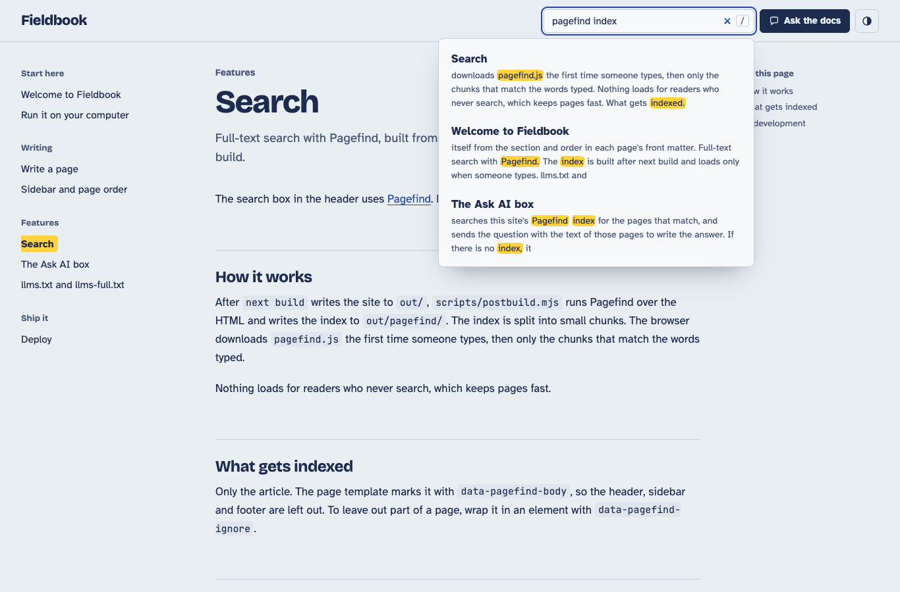

# Next.js AI Docs

A documentation site template for Next.js. Write pages as MDX files in `content/`, and the build gives you a static site with a sidebar, full-text search, `llms.txt` and `llms-full.txt` for AI tools, and an Ask AI box that answers reader questions from your pages with links to them. Light and dark themes. No server and no database.

[](https://vercel.com/new/clone?repository-url=https://github.com/fengyiqicoder/nextjs-ai-docs&env=NEXT_PUBLIC_ONETAG_KEY&envDescription=Your%20OneTag%20AI%20site%20key%20for%20the%20Ask%20AI%20box.%20Public%20by%20design.%20Free%3A%201%2C000%2C000%20tokens%20a%20month%2C%20hard%20cap.&envLink=https://onetagai.com/?ref=nextjs-ai-docs&project-name=ai-docs&repository-name=ai-docs)



## Features

- `llms.txt` and `llms-full.txt` written at build time from the finished pages. No key, no network.
- An Ask AI box. A reader asks in their own words and gets an answer from your pages, with links to the ones it used.
- Pages from MDX files. The folder path is the URL. Front matter sets the title, description, sidebar section and order.
- A sidebar, "On this page" list and previous and next links, all built from the files. No navigation file to maintain.
- Full-text search with [Pagefind](https://pagefind.app). It loads only when someone types. Press `/` to search.
- Code highlighting at build time, in both themes. No highlighter ships to the browser.
- Light and dark themes that follow the system, with a switch in the header.
- Static export to `out/`. Deploys to Vercel or any static host. Lighthouse scores 100 on performance, accessibility, best practices and SEO.

## Install

Click "Deploy" above, or:

```sh
git clone https://github.com/fengyiqicoder/nextjs-ai-docs my-docs
cd my-docs
npm install
npm run dev
```

`npm run dev` is for writing. To see search and the llms files, build and serve the real site:

```sh
npm run build
npm start
```

Then edit `lib/site.ts` (name, description, repository link) and replace the pages in `content/`. The pages that ship with the template explain how everything works.

## Before you deploy: get a free key

```sh
curl -X POST https://onetagai.com/api/signup -H "Content-Type: application/json" -d '{"email":"you@example.com"}'
```

Or get one on [onetagai.com](https://onetagai.com/?ref=nextjs-ai-docs#get-key). Put it in `.env.local` on your computer and in your host's environment variables (the Deploy button asks for it):

```sh
NEXT_PUBLIC_ONETAG_KEY=ot_your_key
```

The key is public by design. It ends up in the built HTML, like an analytics ID. The free plan has 1,000,000 tokens a month with a hard cap, so no bill can appear.

## Options

Environment variables (see `.env.example`):

| Variable | What it does |
| --- | --- |
| `NEXT_PUBLIC_ONETAG_KEY` | Site key for the Ask AI box. Without it the demo key is used, which only answers on localhost |
| `NEXT_PUBLIC_SITE_URL` | Public address of the site, for absolute links in `llms.txt` and canonical tags. On Vercel the production domain is used when this is empty |

The Ask AI script tag in `app/layout.tsx` takes these attributes:

| Attribute | Default here | What it does |
| --- | --- | --- |
| `data-key` | `NEXT_PUBLIC_ONETAG_KEY` | Site key |
| `data-ref` | `nextjs-ai-docs` | Which template the request came from |
| `data-label` | `Ask the docs` | Button and box title |
| `data-position` | `none` | `none` because the header has its own button. `float` or `left` adds a floating one |
| `data-button` | `[data-ask-ai]` | CSS selector of elements that open the box |
| `data-placeholder` | | Text in the empty question field |
| `data-color` | | Accent color, hex without `#` |
| `data-theme` | follows the page | `light` or `dark` |
| `data-lang` | follows the page | `en`, `zh-CN` or `zh-TW` |
| `data-rules` | | Extra instructions for the answers |

Site settings live in `lib/site.ts`. Sidebar section order is `SECTIONS` in `lib/content.ts`. Colors are the variables at the top of `app/globals.css`.

## How it works

1. `next build` renders every file in `content/` to static HTML in `out/` (`output: "export"`). MDX is compiled at build time with `@mdx-js/mdx`, `remark-gfm`, `rehype-slug` and `rehype-pretty-code`.
2. `scripts/postbuild.mjs` runs next:
   - Pagefind indexes the article of every page into `out/pagefind/`.
   - [static-llms-txt](https://www.npmjs.com/package/static-llms-txt) reads the same pages and writes `out/llms.txt` and `out/llms-full.txt`.
   - If no key is set, it prints one warning. The build never fails for a missing key.
3. In the browser, `next/script` loads `https://onetagai.com/ask-docs.js` after the page is interactive. When a reader asks a question, the box finds the matching pages in the Pagefind index and sends the question with their text to OneTag AI, which writes the answer.

## Works without a key

With no key you still get the whole docs site, search, `llms.txt` and `llms-full.txt`. The Ask AI box uses the demo key `ot_demo000000000000000000000`, which answers on `localhost` only, so you can try it with `npm run build && npm start` before signing up.

## License

MIT. See `LICENSE`.
